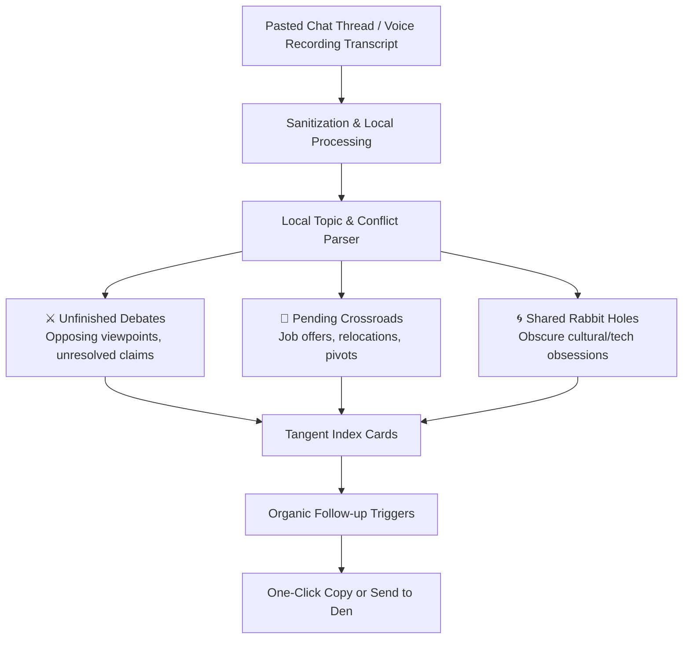

# 🤖 Conversation Memory & Tangent Indexing Architecture
*The Quiet Index Card Box: AI as Table Journal, Not Human Impersonator*

---

> [!WARNING]
> **The Anti-Puppet Principle**: The Den explicitly rejects synthetic AI agents that simulate human companionship, generate fake group banter, or pretend to be friends. Synthetic humans turn digital rooms into eerie puppet theaters. In The Den, AI functions strictly as a quiet, attentive **Table Journal** that documents conversational topography and removes the friction of reconnecting.

---

## 1. Why Synthetic "Buddy" Bots Fail

```
    +---------------------------------------------------------------+
    |                  THE SYNTHETIC BOT FALLACY                    |
    +---------------------------------------------------------------+
    |  Chatbot Puppetry           |  Quiet Tangent Indexing         |
    |  (The Failure Mode)         |  (The Den Architecture)         |
    +-----------------------------+---------------------------------+
    |  Fakes human empathy        |  Indexes real human history     |
    |  Interrupts living room     |  Sits quietly on the table      |
    |  Generates filler chatter   |  Surfaces high-leverage context |
    |  Creates uncanny alienation |  Eliminates catch-up small talk |
    +-----------------------------+---------------------------------+
```

When platforms deploy AI bots to "keep chat active", users instantly disengage. Real intimacy requires **vulnerability and shared risk**. An AI has no skin in the game, experiences no fatigue, and risks nothing. Conversational text generated by bots carries zero emotional weight.

---

## 2. The Tangent Indexing Architecture

In The Den’s **Corner Booth**, the indexer acts like a quiet box of index cards resting between two friends on a table.



### Classification Taxonomy
1. **⚔️ Unfinished Debates (`unfinished_debate`)**:
   * *Signal Triggers*: High token density of contrastive arguments, architecture disagreements, benchmark debates (`vs`, `wrong`, `overhead`, `disagree`).
   * *Goal*: Captures intellectual sparring matches that were cut short by workday interruptions so friends can pick them right back up.
2. **🧭 Pending Crossroads (`unresolved_decision`)**:
   * *Signal Triggers*: Decision verbs, career pivots, relocation discussions, lifestyle questions (`offer`, `moving`, `should I`, `deciding`).
   * *Goal*: Reminds friends to follow up on major life transitions without defaulting to generic small talk.
3. **🌀 Deep Rabbit Holes (`deep_rabbit_hole`)**:
   * *Signal Triggers*: Hyper-specific cultural artifacts, book recommendations, obscure hobbies (`70s city pop`, `synthesizer patches`, `rare books`).
   * *Goal*: Preserves shared obsessions so the context doesn't get lost in message archives.

---

## 3. Conversation Follow-up Triggers

Instead of corporate meeting summaries with action items, the indexer generates natural follow-ups:

| Tangent Type | Extracted Context | Natural Follow-up Opener |
| :--- | :--- | :--- |
| **Debate** | Dave: *"Microservices are overkill for 3 people."*<br/>Badri: *"Network boundary isolation prevents monolith rot!"* | *"Hey Dave, we never settled that argument about monoliths vs microservices from last week..."* |
| **Crossroads** | Dave: *"Got an engineering leadership ping for Tokyo, weighing the timezone shift."* | *"Dave, whatever happened with that Tokyo offer you were weighing?"* |
| **Rabbit Hole** | Both spent 2 hours linking 1980s Casio synthesizer modification videos. | *"I was just thinking about that vintage synthesizer tangent we fell into..."* |

---

## 4. Privacy, Security & Data Sovereignty

* **Zero Training Retention**: Transcripts imported into the tangent parser are processed in-memory and never used to train foundational or public models.
* **Local Processing**: Can run completely on-device against local models (e.g. Ollama or small local quantized weights).
* **Encrypted at Rest**: Tangent index cards are stored strictly within the private local database of that specific Den. No external cloud sync or centralized tracking.
