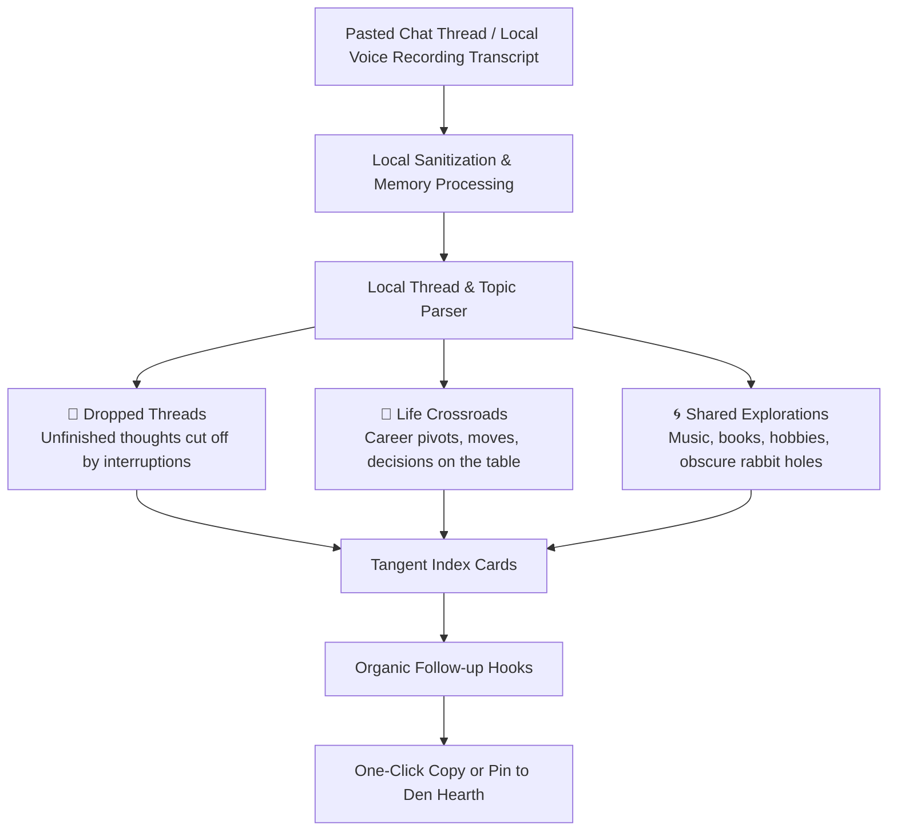

# 🤖 Conversation Memory & Tangent Continuity Architecture
*The Quiet Index Card Box: Rescuing Meandering Conversations from Oblivion*

---

> [!WARNING]
> **The Anti-Puppet Principle**: The Den explicitly rejects synthetic AI agents that simulate human companionship, generate fake group banter, or pretend to be friends. Synthetic humans turn digital rooms into eerie puppet theaters. In The Den, AI functions strictly as a quiet, attentive **Table Journal** that documents conversational topography and removes the friction of reconnecting.

---

## 1. Why Synthetic "Buddy" Bots Fail

```
    +---------------------------------------------------------------+
    |                  THE SYNTHETIC BOT FALLACY                    |
    +---------------------------------------------------------------+
    |  Chatbot Puppetry           |  Quiet Tangent Continuity       |
    |  (The Failure Mode)         |  (The Den Architecture)         |
    +-----------------------------+---------------------------------+
    |  Fakes human empathy        |  Catches dropped real threads   |
    |  Interrupts living room     |  Sits quietly on the table      |
    |  Generates filler chatter   |  Surfaces organic reasons to call|
    |  Creates uncanny alienation |  Eliminates catch-up friction   |
    +-----------------------------+---------------------------------+
```

When platforms deploy AI bots to "keep chat active", users instantly disengage. Real friendship requires vulnerability, shared history, and mutual stakes. An AI has no skin in the game, experiences no fatigue, and risks nothing. Conversational text generated by bots carries zero emotional weight.

---

## 2. The Power of Tangents in Meandering Talks

The best conversations with close friends are long, rambling, and meandering. You jump from how the week felt, to a memory from five years ago, to a strange book, to a half-formed life plan.

The problem is that real life intervenes: a doorbell rings, a work meeting starts, or you fall asleep at 2 AM. Inevitably, fascinating threads get abandoned halfway through. Without an intentional tool, **those tangents become loose ends that dissolve into chat history oblivion**.

With practically zero-cost local transcription (e.g., Whisper running entirely on-device) and zero data leakage, The Den catches those dropped threads without surveillance.



### Classification Taxonomy
1. **🧵 Dropped Threads (`unfinished_tangent`)**:
   * *Signal Triggers*: Unfinished stories, interrupted explanations, topics where one person said *"remind me to tell you about..."* or got cut off.
   * *Goal*: Restores the natural continuity of great conversations so you can pick them right back up.
2. **🧭 Pending Crossroads (`unresolved_decision`)**:
   * *Signal Triggers*: Decision verbs, career pivots, relocation discussions, lifestyle questions (`offer`, `moving`, `should I`, `deciding`).
   * *Goal*: Reminds friends to follow up on major life transitions without defaulting to generic small talk.
3. **🌀 Shared Explorations & Rabbit Holes (`deep_rabbit_hole`)**:
   * *Signal Triggers*: Hyper-specific cultural artifacts, book recommendations, obscure interests (`70s city pop`, `synthesizer patches`, `rare books`).
   * *Goal*: Preserves shared obsessions so the spark doesn't get buried under daily logistics.

---

## 3. Organic Reasons to Reach Out

Instead of corporate summaries with bullet points, the Tangent Tracker surfaces low-pressure, organic conversation hooks:

| Tangent Type | Extracted Context | Natural Follow-up Opener |
| :--- | :--- | :--- |
| **Dropped Thread** | Call cut off when Priya's flight boarded while explaining a studio project. | *"Hey, your flight was boarding right when you started telling me about that studio build—what happened with that?"* |
| **Crossroads** | Dave: *"Got an engineering leadership ping for Tokyo, weighing the timezone shift."* | *"Dave, whatever happened with that Tokyo offer you were weighing?"* |
| **Shared Exploration** | Both spent 45 minutes talking about 1980s Casio keyboard solder mods before sleep. | *"Still thinking about that vintage synth modification rabbit hole from Tuesday."* |

---

## 4. Privacy, Security & Data Sovereignty

* **Zero Training Retention**: Transcripts imported into the tangent parser are processed in-memory and never used to train public models.
* **100% Local Processing**: Transcriptions and thread extraction run entirely on-device using local models (Whisper / local quantized models).
* **Encrypted at Rest**: Tangent index cards are stored strictly within the private local database of that specific Den. No telemetry leaves your machine.
