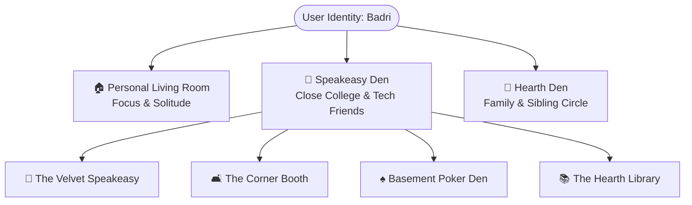

# 💎 Business & Product Strategy: The Den
*An Anti-Engagement Farm Economic & Product Architecture for Authentic Connection*

---

> [!IMPORTANT]
> **Executive Thesis**: Mainstream social media companies are advertising brokerages disguised as communication networks. They monetize attention fragmentation, outrage, and synthetic dopamine loops. *The Den* is engineered as a bounded, paid-sanctuary utility that treats friendship not as content to be consumed, but as an intimate human sanctuary to be preserved.

---

## 1. The Anti-Farm Economic Model: "The Trio & The Extra Chair"

### The Failure of Traditional Monetization
1. **Ad-Supported Feeds (The Surveillance Trap)**: Forces platforms to optimize for session length, outrage algorithmics, and clickbait notification spam. Friends become eyeballs sold to advertisers.
2. **The "Host Pass" SaaS Toll ($9.99/mo)**: Recurring subscriptions punish the most dedicated organizer and feel like a hostage toll. If the host cancels, the friendship sanctuary vanishes, creating immediate churn and resentment.

```
       TRADITIONAL SOCIAL MEDIA                  THE DEN SANCTUARY
    +-----------------------------+         +--------------------------+
    | Infinite Algorithmic Feed   |         | Bounded Living Room (15) |
    | Intrusive Targeted Ads      |   VS    | Zero Ads • Zero Tracking |
    | Monthly Host Tolls / Subs   |         | Trio Free + $3.99 Chair  |
    | Artificial Dopamine Loops   |         | Asynchronous Ambient Glow|
    +-----------------------------+         +--------------------------+
```

### The Den Economic Framework
* **The Core Trio (Free Forever)**: Every user gets their central inner sanctum—themselves and their 2 closest friends (3 participants total)—completely free with full spatial fidelity, avatar studio customization, ambient exhaust streaming, and thread continuity.
* **The Physical Chair Purchase ($3.99 One-Time per Stool)**:
  * When a group expands beyond the initial Trio, any member can purchase an additional permanent physical stool for $3.99.
  * **No recurring subscription**. You are buying a piece of furniture for your friend in the room. Once bought, that stool belongs to that friend in that Den forever.
  * **Friction as a Quality Filter**: Paying a small one-time fee creates psychological investment and enforces intentionality. You do not invite casual acquaintances when a chair costs real money.
* **The Sacred Dunbar Ceiling (Strict Cap at 15)**:
  * No Den can ever exceed 15 members under any circumstances.
  * This prevents the app from degrading into a Slack workspace, a broadcast channel, or a high-school cafeteria.

---

## 2. Product Architecture & Multi-Den Isolation

Friendships are not homogeneous. A user’s emotional persona and social boundaries shift across contexts:



### Context Isolation Guarantee
* **No Cross-Pollination**: Jokes, lore, Spotify exhausts, and chat imports in the *Buddies Den* are cryptographically and logically isolated from the *Family Den*.
* **Zero Mutual Obligation**: User A can invite User B to their Buddies Den without User B having to invite User A into their private family sanctuary.

---

## 3. The Corner Booth & Tangent Cartography (Retention Engine)

The single greatest driver of long-term retention in adult relationships is **conversational continuity**. Adults drift apart not because they dislike each other, but because the cognitive cost of catching up becomes too high.

### The Mechanics of the Whisper Nook
1. **Intimate Breakout**: A 2-to-3 person spatial nook that allows intimate conversations away from the main group living room.
2. **Tangent Extraction Engine**: Users import chat threads (WhatsApp export, Signal snippet, voice note transcripts). The local NLP engine extracts:
   * **⚔️ Unfinished Debates**: Controversial, unresolved discussion topics.
   * **🧭 Pending Crossroads**: Upcoming life decisions, career pivots, relocation dilemmas.
   * **🌀 Shared Rabbit Holes**: Obscure cultural or intellectual fascinations.
3. **Frictionless Re-Engagement**: Provides copyable, context-rich conversation starters that eliminate awkward small talk.

---

## 4. Data Sovereignty & Privacy Principles

* **Zero Scraping & Zero Social Graph Harvesting**: The Den never reads external phone contacts, does not scrape browser history, and does not build shadow social graphs.
* **Client-Authenticated Ambient Exhaust**: Spotify, Letterboxd, and GitHub streams are opt-in, read-only metadata broadcasts that users authenticate themselves.
* **2-Party Mutual Lore Consecration**: Inside jokes and quotes are transient by default. They are only permanently committed to the communal vault when two separate members consecrate them.

---

## 5. Summary Financial Projections (Indie Bootstrapped Scale)

| Metric | Target Year 1 | Target Year 2 | Unit Economics |
| :--- | :--- | :--- | :--- |
| **Active Dens** | 10,000 | 75,000 | Free Trio Core |
| **Average Stools per Den** | 5.2 | 6.8 | $3.99 per seat after 3 |
| **Paid Chair Purchases** | 22,000 chairs | 285,000 chairs | $3.99 one-time gross |
| **Gross Seat Revenue** | $87,780 | $1,137,150 | 100% margin on seat slots |
| **Infrastructure Cost** | ~$450 / month | ~$2,800 / month | Lightweight FastAPI + WebSockets |
| **Net Operational Health** | Self-sustaining indie | High profitability | Zero VC growth treadmill |
