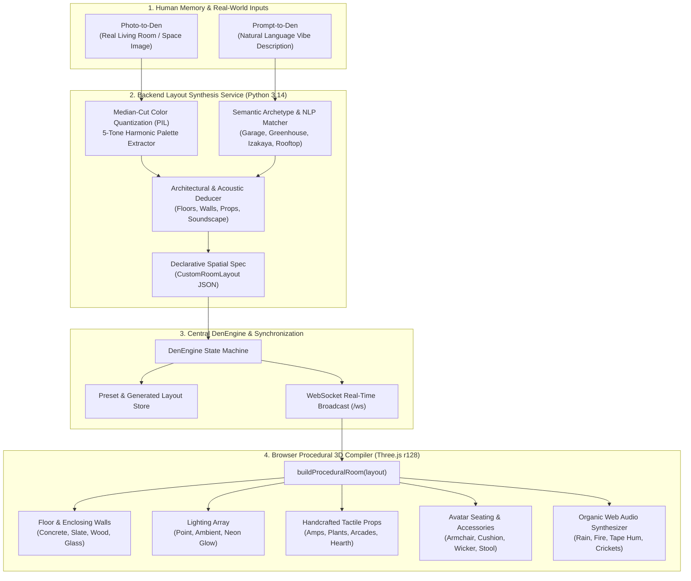

# Custom Den Layout Engine: Procedural Spatial Synthesis Architecture

> [!NOTE]
> **Artisan Ethos**: In alignment with Eric Barone's (ConcernedApe) craft philosophy, *The Den* rejects sterile, empty procedural boxes. Every synthesized layout produces a tactile, emotionally resonant living space equipped with specific material textures (concrete, parquet oak, tatami, slate), atmospheric lighting (Edison pendants, fire embers, neon glow), acoustic soundscapes, and meaningful props (twin guitar amps, record players, potted foliage, retro arcades).

---

## 1. Architectural Overview & System Topology

The Custom Den Layout Engine bridges unstructured natural language memories ("my college garage band space") and real-world photographic scenes into fully interactive, bounded 3D WebGL environments rendered live in the user's browser.

---

## 2. Key Synthesis Pipelines

### A. Prompt-to-Den: Semantic Memory Extraction
When users provide descriptions of nostalgic or aspirational dens, `LayoutService.generate_from_prompt(prompt)` categorizes the input into distinct spatial archetypes using semantic keyword analysis:

1. **90s Grunge Garage Rehearsal Nook**:
   - *Keywords*: `garage`, `band`, `grunge`, `punk`, `rehearsal`, `amp`, `rock`
   - *Materials*: Exposed brick walls (`#2b170e`), rough concrete floor (`#1c1a19`).
   - *Lighting*: Warm Edison string lights (`#ffbe5b`, 2.2 intensity) and red neon back-glow.
   - *Props*: Dual Marshall-style 4x12 guitar amp stacks with cloth grilles, glowing tube head jewel lights, glowing neon sign, thrift leather armchairs.
   - *Acoustics*: Low-frequency analog `tape_hum`.

2. **Rainy Botanical Greenhouse Sanctum**:
   - *Keywords*: `greenhouse`, `plant`, `garden`, `botanical`, `monstera`, `flora`
   - *Materials*: Translucent greenhouse glass panes with dark iron mullions, slate stone floor (`#1a2b20`).
   - *Lighting*: Cool skylight ambient glow (`#34d399` accent) with dim rain clouds.
   - *Props*: Multi-scale potted monsteras and ferns in terracotta planters, round low mahogany table, woven emerald rug, vinyl turntable.
   - *Acoustics*: Bandpass-filtered `rain` on glass.

3. **Tokyo Neon Izakaya Nook**:
   - *Keywords*: `tokyo`, `izakaya`, `cyber`, `ramen`, `neon`, `shinjuku`
   - *Materials*: Dark cedar wood panels, slate tiles, Japanese tatami mats.
   - *Lighting*: Vivid cyan and magenta neon tube fixtures, deep atmospheric fog.
   - *Props*: Retro 80s upright arcade cabinet (tilted CRT screen, glowing marquee, joystick), glowing neon typography, swivel barstools.
   - *Acoustics*: Midnight rain and analog ambient buzz.

4. **Rooftop Sunset Porch**:
   - *Keywords*: `rooftop`, `porch`, `sunset`, `patio`, `balcony`, `terrace`, `deck`
   - *Materials*: Weathered cedar decking planks, open twilight skyline.
   - *Lighting*: Amber golden-hour point light (`#ff7849`, 2.8 intensity) with warm fairy lights.
   - *Props*: Weathered wicker chairs, potted lavender, purple velvet rug, acoustic turntable.
   - *Acoustics*: Procedural `night_crickets` and warm breeze.

5. **Deterministic Hash Fallback**:
   - When open-ended or poetic prompts are submitted (e.g. *"an underground alchemical study"*), `hashlib.sha256` generates deterministic architectural parameters, light coordinates, and color values, ensuring stable procedural generation.

---

### B. Photo-to-Den: Computer Vision & Color Quantization
When an image is uploaded (e.g., a photo of a user's real apartment living room or childhood basement):

1. **Median-Cut Color Quantization**:
   - `_extract_palette_from_image(image_bytes)` resizes the image down to 64×64 pixels and executes median-cut quantization down to 5 dominant clusters using Pillow's `Image.Quantize.MEDIANCUT`.
   - If Pillow is unavailable, a SHA-256 byte-sampling fallback safely computes an aesthetically balanced hex palette.

2. **Harmonic Role Assignment**:
   - Dominant color 0 $\rightarrow$ `background_color` & `fog_color` (Room volume)
   - Dominant color 1 $\rightarrow$ `floor_color` (Foundation plane)
   - Dominant color 2 $\rightarrow$ `accent_color` (Pendant lighting & neon signs)
   - Dominant color 3 $\rightarrow$ `wall_color` (Enclosing structure)
   - Dominant color 4 $\rightarrow$ `rug_color` & trim

3. **Contextual Hint Extraction**:
   - The user can supply an optional contextual hint (e.g. *"Our college apartment with the brick fireplace"*).
   - The engine checks for hints like `brick`, `concrete`, `plant`, `garden`, dynamically assigning `floor_type`, `wall_type`, and tactical props.

---

## 3. Procedural 3D Scene Compiler (`buildProceduralRoom`)

Unlike traditional metaverse engines that download 50MB glTF/GLB models over high-latency networks, *The Den* compiles its 3D spaces procedurally in pure WebGL via Three.js r128:

| Spatial Component | Procedural Geometry Construct | Material & Physical Rendering |
| :--- | :--- | :--- |
| **Room Floor** | `PlaneGeometry(24, 18)` | Standard PBR with tailored roughness (concrete: 0.9, slate: 0.3, wood: 0.45). |
| **Enclosing Shell** | 3× `PlaneGeometry` (Back, Left, Right) | Opaque PBR walls or semi-transparent glass panes (`opacity: 0.55`) with iron mullions. |
| **Amp Stack** | 2× `BoxGeometry(1.2, 1.1, 0.65)` + Head | Black tolex texture, silver cloth grilles, gold faceplate, and a glowing red sphere jewel lamp (`0xef4444`). |
| **Indoor Flora** | `CylinderGeometry` pot + 5× `SphereGeometry` | Terracotta pot with rich dark soil and multi-scale green foliage clusters. |
| **Neon Sign** | 2× `BoxGeometry` tube segments | Emissive glowing material (`emissiveIntensity: 0.95`) coupled with an active `PointLight`. |
| **Arcade Cabinet** | Upright angled `BoxGeometry` | Glowing CRT screen, marquee banner, coin box, and miniature joystick (cylinder + red sphere ball). |
| **Record Player** | Walnut `BoxGeometry` + `CylinderGeometry` disc | Plinth with spinning vinyl platter (`vinylDiscMesh`) and gold tonearm; registers as an interactive Jukebox. |
| **Acoustic Hearth** | Stone `BoxGeometry` surround + Birch log cylinders | Fireplace cavity with stacked birch logs, flame cones, and amber point light; registers as a focus Hearth. |
| **Seats & Avatars** | Armchairs, Floor Cushions, Wicker Chairs, Stools | Avatars seated with custom beanies, caps, hair, and drink accessories; tracks camera and speech bubbles. |

---

## 4. API Endpoints Contract

The new `den_prototype/routers/layout_router.py` exposes REST endpoints mounted at `/api/layouts`:

- `GET /api/layouts`: Returns list of all available presets and user-generated layouts.
- `GET /api/layouts/{layout_id}`: Returns full spatial specification for a single layout.
- `POST /api/layouts/prompt`: Synthesizes a layout from `{ "prompt": string }`.
- `POST /api/layouts/upload`: Multipart upload with `file: UploadFile` and optional `hint: string`.
- `POST /api/layouts/select`: Activates a layout and broadcasts state to all connected WebSocket clients.

---

## 5. Verification & Reliability Metrics

The entire layout engine was tested against unit, integration, and headless browser runtime suites:

- **Python Tests**: 65/65 unit and integration tests passing (`py -3.14 run_tests.py`).
- **Node.js AST Validation**: 3 inline script blocks verified with `node --check`.
- **Three.js VM Execution**: Verified in headless Node.js VM running official Three.js r128 without errors across all 5 spatial modes (Speakeasy, Booth, Poker, Library, and Custom Procedural Den).
