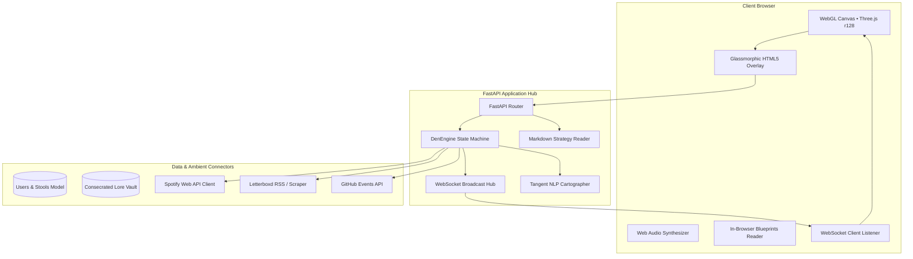

# ⚡ Software Development Plan & Hackathon Blueprint
*Full-Stack Architecture, API Specifications & Execution Roadmap*

---

> [!IMPORTANT]
> **Engineering North Star**: The Den is engineered for instant load times (<1.2s), zero-setup browser accessibility, zero third-party tracking libraries, and robust real-time bidirectional WebSocket synchronization.

---

## 1. System Architecture Diagram



---

## 2. API Endpoints Specification

### 2.1 State & Session
* `GET /api/state`: Returns the full `DenState` JSON snapshot including users, active ambient streams, active poll, slow board game state, and corner booth tangents.
* `POST /api/den/switch`: Switches between `personal`, `buddies`, and `family` Den contexts.
* `WS /ws`: Bidirectional WebSocket connection broadcasting state delta updates to all connected room clients upon any event.

### 2.2 Customization & Exhaust
* `POST /api/user/avatar`: Updates 3D avatar configuration (outfit color, skin tone, hair style/color, signature drink, accessories).
* `POST /api/user/feeds`: Updates ambient exhaust configuration (Spotify track/artist, Letterboxd rating/review, GitHub repo/commit, custom status).
* `POST /api/ambient/simulate`: Development test harness for triggering immediate simulated feed changes.

### 2.3 The Corner Booth & Tangents
* `POST /api/booth/import`: Ingests raw chat transcripts (WhatsApp, Signal, Telegram, voice notes) and extracts unresolved debates, pending decisions, and rabbit holes with copyable starters.
* `GET /api/artifacts`: Reads and returns markdown strategy files from disk for in-browser inspection.

### 2.4 Social Rituals & Dunbar Growth
* `POST /api/ember`: Sends an asynchronous warm glow (Ember) from one friend's drink coaster to another.
* `POST /api/roast`: Dispatches a playful roast to a buddy based on their current ambient activity.
* `POST /api/lore/consecrate`: Registers 2-party consent to permanently memorialize an inside joke.
* `POST /api/game/roll`: Advances the turn in the asynchronous Slow Board Game.
* `POST /api/friends/add_test`: Unlocks an additional chair for $3.99 up to Dunbar limit 15.

---

## 3. 48-Hour Hackathon Execution Plan

```
    +--------------------------------------------------------------------------+
    |                         48-HOUR HACKATHON SPRINTS                        |
    +--------------------------------------------------------------------------+
    | Phase 1: Friday 18:00 - 24:00 | Core Spatial Engine & WebGL Scenery      |
    | Phase 2: Saturday 08:00- 14:00| Avatar Studio & Web Audio Synthesizer    |
    | Phase 3: Saturday 14:00- 20:00| Ambient Exhaust Pipes & WebSocket Hub    |
    | Phase 4: Saturday 20:00- 24:00| Corner Booth & Tangent Cartographer      |
    | Phase 5: Sunday 08:00 - 12:00 | In-Browser Blueprints Reader & Polish    |
    | Phase 6: Sunday 12:00 - 16:00 | Zero-Error VM Audits & Demo Rehearsal    |
    +--------------------------------------------------------------------------+
```

### Sprint Deliverables
1. **Milestone 1 (Foundations)**: Fixed Three.js isometric camera, soft shadow mapping, mahogany bar, and dog Byte breathing on rug.
2. **Milestone 2 (Auditory & Physical Touch)**: Native Web Audio glass clinks and dice rolls with zero external audio assets.
3. **Milestone 3 (Ambient Exhaust)**: Live Spotify, Letterboxd, and GitHub pipes syncing state via WebSocket.
4. **Milestone 4 (Intimate Continuity)**: Corner Booth room setup and Tangent Cartographer NLP thread importer.
5. **Milestone 5 (Master Artifacts)**: Interactive in-browser documentation reader for judges and technical auditors.

---

## 4. Verification & Testing Protocols

```bash
# 1. Run Node.js AST syntax check & headless Three.js r128 VM room verification
py -3.14 test_den_js.py

# 2. Launch FastAPI background service on port 8765
py -3.14 run_den_prototype.py
```

* **Zero-Error Node.js VM Test**: Evaluates all script blocks, tests `init3D()`, and sequentially renders `bar`, `booth`, `poker`, and `library` scenes in a headless VM to guarantee zero `TypeError` or missing constructor regressions.
* **WebSocket Heartbeat**: Verifies clients auto-reconnect within 2000ms upon network degradation.
