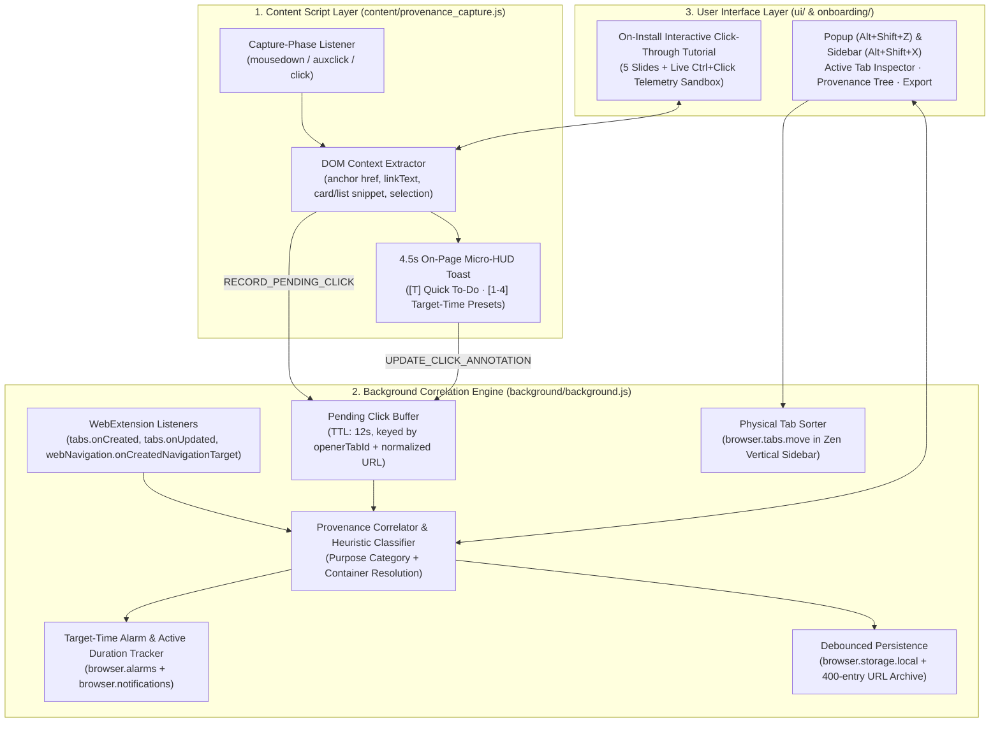
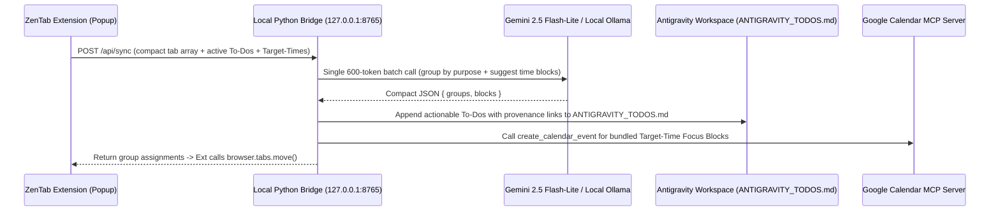

# ZenTab Provenance — Software Architecture & Future LLM/MCP Blueprint

## 1. System Architecture Overview (Current MVP — Zero External Dependencies)

ZenTab Provenance is architected around three decoupled layers inside the Mozilla/Zen WebExtension runtime:



---

## 2. Deep-Dive: The 3-Layer `Ctrl+Click` Provenance Correlation Engine

### Why Standard `tabs.onCreated` Alone Fails
When a user `Ctrl+Click`s a link in Firefox/Zen:
1. `browser.tabs.onCreated` fires immediately with `tab.url === "about:blank"` and `tab.openerTabId`.
2. Neither `tabs.onCreated` nor `webNavigation` knows **which specific `<a href>` element** on the parent page was clicked, what its **anchor text** was, or what **surrounding paragraph/card description** accompanied it (especially if the parent page links to the same destination multiple times or routes through a redirect).

### How ZenTab Solves This
1. **Capture-Phase Pre-Flight (`provenance_capture.js`):**
   - Runs at `document_start` with `window.addEventListener("mousedown", ..., true)` and `click`/`auxclick` in the capture phase.
   - Traverses `event.composedPath()` (supporting Shadow DOM) to find the `<a>` element.
   - Walks up 1–6 ancestor nodes (`<li>`, `<article>`, `.Box-row`, `.card`, `<p>`) to extract a 20–360 character **DOM Context Snippet** with UI button noise (`Star`, `Fork`, `Watch`) stripped out.
   - Sends `RECORD_PENDING_CLICK` to `background.js` and receives a correlation `clickId`.
2. **Correlation Queue Matching (`background.js`):**
   - When `tabs.onCreated` and `webNavigation.onCreatedNavigationTarget` fire, `findMatchingPendingClick(openerTabId, candidateUrl)` matches the pending click using a 3-stage priority:
     1. Exact `sourceTabId === openerTabId` + normalized `targetUrl` match.
     2. Normalized `targetUrl` match within a 5,000ms window (handles `rel="noopener"` links where Firefox strips `openerTabId`).
     3. Most recent unmatched click from `sourceTabId === openerTabId` within 3,500ms (handles initial `about:blank` states and 302 redirects).
3. **Asynchronous Micro-HUD Patching:**
   - Because `clickId` is bound to `matchedTabId` as soon as the child tab is created, typing a To-Do or clicking `+30m` in the parent page's **Micro-HUD Toast** 3 seconds *after* `Ctrl+Click` seamlessly patches the background tab's record and schedules its `browser.alarms` reminder.

---

## 3. Data Schema (`browser.storage.local`)

```json
{
  "tabId": 42,
  "windowId": 1,
  "index": 7,
  "pinned": false,
  "url": "https://github.com/wuyoscar/Internal-Safety-Collapse",
  "domain": "github.com",
  "title": "wuyoscar/Internal-Safety-Collapse",
  "openedAt": 1792418712000,
  "lastUpdatedAt": 1792418745000,
  "activeDurationMs": 48200,
  "container": {
    "name": "Personal",
    "color": "blue",
    "cookieStoreId": "firefox-container-1"
  },
  "spaceTag": "AI Safety",
  "purposeCategory": "AI Safety & SecOps",
  "userSetPurpose": false,
  "provenance": {
    "triggerType": "ctrl+click",
    "openerTabId": 12,
    "sourceUrl": "https://github.com/stars",
    "sourceDomain": "github.com",
    "sourceTitle": "Your Stars",
    "linkText": "wuyoscar / Internal-Safety-Collapse",
    "surroundingSnippet": "[NeurIPS 2026] We built an adversarial codespace setup. Place any AI agent into a normal workflow inside it.",
    "selectedText": "",
    "modifiers": { "ctrlKey": true, "shiftKey": false, "button": 0 },
    "capturedAt": 1792418711950
  },
  "note": "Check their adversarial codespace benchmark harness.",
  "todo": "Clone repo and inspect benchmark tasks",
  "todoDone": false,
  "targetTime": 1792423800000,
  "targetDurationMin": 25
}
```

---

## 4. Future Phase 2 Blueprint: Maximally Cheap LLM + MCP Integration

When you are ready to enable **Phase 2 (LLM Smart Grouping + Direct MCP Calls to Google Calendar & Antigravity)**, the architecture is designed to keep LLM costs at **$0.00 (Free Tier)** or **<$0.00008 per 30-tab batch**.

### 4.1 Token-Minimization Strategy ("Micro-Schema Batching")
Never call an LLM per tab open, and never send raw HTML or tracking query parameters.
1. **Tier-0 Heuristic Pre-Filter (0 Tokens):**
   - Tabs that already share a known `openerTabId` hub or match deterministic regex rules in `inferPurposeCategory()` are pre-labeled locally.
2. **Tier-1 Batched Micro-Schema Prompt (~20 Tokens / Tab):**
   - Only when you click **"AI Smart Group & Schedule"** are open tabs serialized into a single compact JSON array:
     ```json
     [
       {"i":14,"t":"splunk/attack_data","p":"Your Stars","s":"curated datasets from attacks","td":"Audit dataset"},
       {"i":15,"t":"wuyoscar/Internal-Safety-Collapse","p":"Your Stars","s":"NeurIPS 2026 adversarial codespace","td":""}
     ]
     ```
   - **Model Choice:**
     - **Option A (Cloud Free Tier / Ultra-Cheap):** `gemini-2.5-flash-lite` via Google AI Studio (Free tier: 15 RPM / 1,000 RPD; Paid tier: $0.075 / 1M input tokens = **$0.00006 per 30-tab batch**).
     - **Option B (100% Local Offline):** Local Ollama (`http://127.0.0.1:11434/api/chat` with `qwen2.5:3b` or `llama3.2:3b`) or Firefox's built-in `browser.trial.ml` engine.

### 4.2 Local Companion MCP Bridge (`mcp_bridge.py` on `127.0.0.1:8765`)
Because Firefox WebExtensions are sandboxed from spawning local `stdio` processes or writing directly to arbitrary workspace files, a 120-line local Python HTTP service bridges the extension to your local MCP ecosystem:



### 4.3 Reusable Open-Source Codebases for Phase 2
- **[`piroor/treestyletab`](https://github.com/piroor/treestyletab):** Reference for handling complex multi-level tab tree reparenting when intermediate tabs are closed.
- **[`josh-berry/tab-stash`](https://github.com/josh-berry/tab-stash):** Reference for bookmark-backed cold storage of stashed tab groups.
- **[`modelcontextprotocol/python-sdk`](https://github.com/modelcontextprotocol/python-sdk):** Official `FastMCP` client/server library for wiring `mcp_bridge.py` to Google Calendar and workspace task tools.
